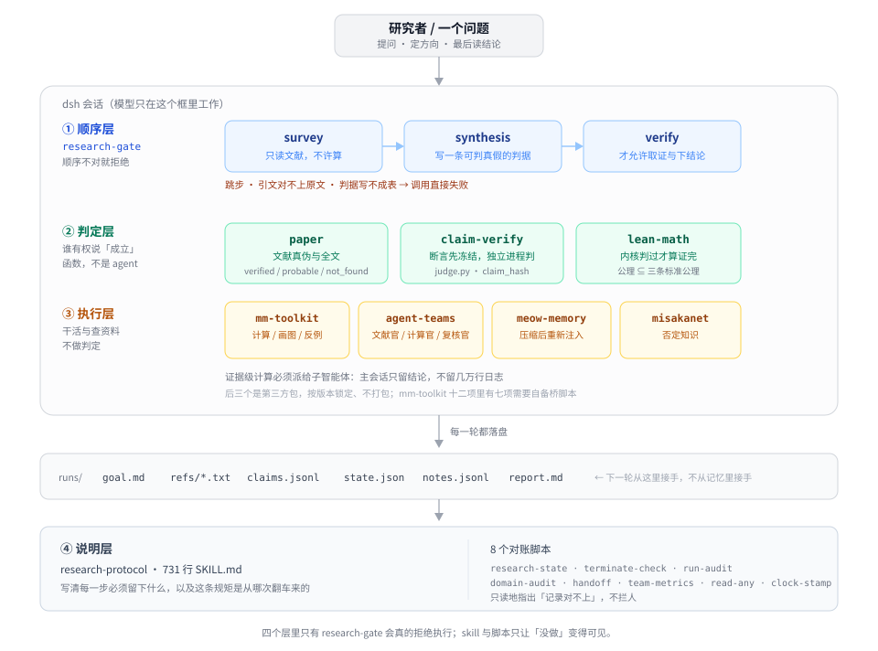

# dsh-math-flow

**An agent workflow for mathematical research. It does not make the model more capable; it constrains the order in which the model is allowed to work: read first, write a criterion second, compute last.**

[中文](README.zh-CN.md) · runs on DeepSeek Harness (`dsh`) · verdicts rely on Lean 4 + Mathlib

> Status: alpha, installable and runs end to end. Only verified on `dsh 0.1.5-rc.2`; see [section 5](#5-status-and-plans).

**Contents**: [1. What goes wrong](#1-what-goes-wrong-with-an-agent-take-dsh) · [2. The framework](#2-the-framework) · [3. Plugins and skills](#3-plugins-and-skills) · [4. Install](#4-install) · [5. Status and plans](#5-status-and-plans)

---

## 1. What goes wrong with an agent (take `dsh`)

None of the eight items below is a guess. They were recorded over months of long sessions on one class of task: take a maths problem, find out what has been done, try to compute or prove something. Each one points at a specific round.

| # | Failure | What it looks like in `dsh` | Cost |
|---|---|---|---|
| 1 | **Order collapses** | Given an open problem it reads 0 papers, calls 0 paper tools, spends 5 minutes designing a numeric search, and prepares to run to 10⁵ | On an unbounded problem a small search carries almost no information; the information is in *why* there should be no solution |
| 2 | **Definitions drift** | A symbol defined in round 5 is subtly different by round 40 and is proving something else by round 60 | Long derivations fail silently |
| 3 | **Self-certification** | Whoever states the claim also declares it true | "Verified" can be about a different theorem |
| 4 | **Only two verdicts** | No "inconclusive", so "found no counterexample" becomes "true" | Reports are systematically optimistic |
| 5 | **Compaction is amnesia** | After compaction the summary's wrong premises are inherited as fact; experiments and conclusions share one session | Errors get institutionalised |
| 6 | **More tools, more confusion** | One agent can both search and compute, so it oscillates — always toward whatever produces a number fastest | Adding plugins makes it worse |
| 7 | **Installed ≠ mounted** | Version skew silently downgrades a plugin; two memory plugins compete for one injection slot and you get one paragraph written twice | Expensive to diagnose, and still no error |
| 8 | **No measurement** | After a change, the honest report is "felt better this time" | You cannot tell which change helped or delete the ones that did not |

Three of them are worth spelling out.

**Skipping the literature.** The problem was whether a point exists inside the unit square whose distances to all four vertices are rational. The model read nothing, went straight to a search design, and aimed at `c ≤ 10^5`. That search can neither prove existence nor non-existence, but it looks like work.

**Self-certification.** One audit produced `theorem trivial_thing : 1 = 1` while the `assertion` field described an unrelated theorem. Verdict: pass, zero axioms, every check green. The checker did not lie; it was handed something irrelevant.

**Installed but not mounted.** A dozen packages on disk, one fewer actually mounted in the profile, and `dsh` reported nothing. That is why verification now reads `dsh --dump-config` and checks each plugin's **real component id**, never the package name.

The common property: **none of these throws an error.** The model does not say "I forgot the definition"; it keeps going, in perfectly formatted output. Prompts cannot fix this and neither can a stronger model. That is the reason this repository exists: move the constraint out of prose and into the tool layer, where "should" becomes "cannot".

## 2. The framework

The design is one sentence: **anything mechanically decidable becomes a function, order becomes a gate, the rest becomes documentation you can audit.**

Four layers. The figure says the same thing; the text adds the mechanics.

<p align="center"></p>

| Layer | Owns | Implemented by | What happens when it is violated |
|---|---|---|---|
| ① Order | which step you are in and what it permits | `research-gate` | the tool call fails and says what is missing |
| ② Verdict | who may say "true" | `lean-math` / `claim-verify` / `paper` | error or "inconclusive", never a fake pass |
| ③ Execution | search, compute, plot, delegate | `mm-toolkit` + three third-party packages | names the missing dependency instead of pretending |
| ④ Explanation | what each step must leave on disk | `research-protocol` skill + 8 audit scripts | blocks nothing; makes "not done" visible |

### ① Order: `research-gate`

A state machine over three stages, forward only:

```
survey ──→ synthesis ────→ verify
read only     write one criterion     evidence allowed
```

It refuses four things:

- **Skipping.** Calling `research_stage(advance)` before survey is done fails.
- **Invented quotes.** Survey needs at least two verbatim quotes from different local files; the check is a whitespace-normalised substring match. Paraphrase, stitching and translation do not count.
- **Criteria that are not criteria.** Synthesis must produce something readable as `judge + predicate + value`, plus the condition that would refute it. Prose does not advance.
- **Batch computation in the main session.** Evidence- and explore-tier computation must be delegated; the main session keeps the conclusion, not tens of thousands of log lines.

Computation is tiered by size, not by subject: `scratch` (single evaluation, allowed at any stage, must be tagged `[scratch]`), `evidence` (loops, bounds, enumeration), `explore` (bounds ≥ 10⁵, Monte Carlo, parameter sweeps). A frequency rule closes the obvious hole: after 8 scratch computations on one problem, further calls are promoted to evidence tier — you cannot buy a scan in small instalments.

Since v0.4 the roles are isolated at the schema level: the surveyor cannot see `viz_python`, the computer cannot see `paper_*`, the adversary exists to find counterexamples. The tool is not in the sub-session's schema, so it cannot be misused.

One rule came from a real deadlock: **loosen rather than jam.** Some profiles have neither `subagent` nor a shell; requiring delegation makes the pipeline unable to proceed at all. The gate probes for a delegation tool, and if none exists it allows the call but counts it in `directRuns` and shows "degraded: N direct runs" in its status. Degradation is visible and counted, not silent.

### ② Verdict: nobody signs their own certificate

- **`lean-math`** puts the Lean kernel in the loop. `lean_verify_proof` is the final judge; `lean_axioms` reports which axioms each declaration depends on, and `uses_sorry: true` means the proof is not finished. `proven` is defined in code: axioms ⊆ `{propext, Classical.choice, Quot.sound}` and `autoImplicit` off.
- **`claim-verify`** fixes the "the producer of data is also the judge" problem by splitting them into two processes. The script prints data (one JSON object per line); `judge.py` decides from a pre-declared `expect`. After the verdict the claim text is frozen by hash; editing it afterwards shows up in `claim_audit` as a distinct event instead of being silently accepted.
- **`paper`** owns "does this citation exist and can I get the full text". Verification has three outcomes: `verified` (title similarity ≥ 0.9, no year/author conflict), `probable` (0.75–0.9, needs a human check), `not_found` (< 0.75, unverified, must not enter the prose). Pirate mirrors are rejected in `checkPolicy()` — in code, not in a paragraph.

### ③ Execution: where work happens, not where verdicts happen

`mm-toolkit` computes and plots. Three third-party packages add memory, teams and negative knowledge. All of them can fail, and they say which dependency is missing; none of them can sign a conclusion.

### ④ Explanation: write down what "done" means, and make it auditable

`skills/research-protocol/SKILL.md` is 731 lines: what each stage must leave behind, why, and which round the rule came from (about 30 named failure modes, with round numbers). Eight scripts read a run directory and check whether its own records hold together.

This layer **enforces nothing**. A skill that is not loaded does not exist; the scripts must be run and read by a human. The only thing that will actually stop you is `research-gate`. Conflating the two is the most common way projects like this overstate themselves.

### What one task actually looks like

1. Write the goal to `goal.md`: the problem, the success criterion, what is explicitly out of scope, why it is hard.
2. **survey** — use `paper_*` to search, resolve open full text, verify citations; leave four answers (who, reduced to what, by what method, stuck where) and two verbatim quotes.
3. **synthesis** — write one criterion and its refutation condition. If it cannot be written as a table, go back.
4. **verify** — write `prediction` and `confidence` first, then run. Evidence-tier computation goes to the computer; theorems go to `lean_verify_proof`; numeric claims go to `verify_claim`.
5. **report** — every statement tagged `[known]` / `[computed]` / `[scratch]` / `[conjecture]`, every claim carrying its `claim_hash`.
6. **close** — run `terminate-check` and `run-audit`, confirm `state.json` agrees with `claims.jsonl`, then declare the round finished.

## 3. Plugins and skills

Five plugin packages (36 tools), three skills, eight audit scripts.

### 3.1 `lean-math` — kernel verdicts (13 tools)

A resident Lean language server: imports load once, and each step re-parses only the change.

| Tool | What it does |
|---|---|
| `lean_status` | check elan / lean / lake / curl |
| `lean_open_file` / `lean_sessions` / `lean_close_session` | open, list, close interactive sessions |
| `lean_get_goals` | current goals and diagnostics (the eyes) |
| `lean_run_tactic` | append one tactic and return the new state (the hands) |
| `lean_update_source` | swap the theorem in the same session, reusing imports (~1s instead of 40–60s) |
| `lean_undo` | return to any checkpoint |
| `lean_verify_proof` | full kernel check of a complete snippet (final judge) |
| `lean_axioms` | axiom dependencies per declaration; detects `sorry` |
| `lean_deps` | dependency graph: transitive closure, modules, edges |
| `lean_query` | `#check` / `#eval` / `#print` / `#reduce` in session |
| `lean_search_premise` | Mathlib premise search (leansearch / moogle / premise-search) |

**It refuses** anything that does not compile, contains `sorry`, uses axioms outside the allowed set, or leaves `autoImplicit` on. It does not judge whether a theorem matters, only whether the kernel accepts it.

### 3.2 `claim-verify` — frozen claims (4 tools)

| Tool | What it does |
|---|---|
| `verify_claim` | run the script, read JSON lines, judge from the declared `expect`, freeze the claim by hash |
| `claim_audit` | was a criterion edited after it was judged? |
| `lean_audit` | compile a Lean file and return `proven` / `computed` / `failed` / `blocked` |
| `research_note` | append to the research ledger |

**It refuses** criteria that cannot be translated into `judge + predicate + value`; vacuous passes (perturbing every input row flips nothing → `verdict: "vacuous"`); scripts whose data contradicts their declaration.

### 3.3 `research-gate` — the order gate (1 tool)

One public tool, `research_stage`; the machinery is the state machine: stage advance, ticket (a new problem needs a new ticket), scratch quota, computation tiering, delegation check, role tool policy, and refusals that name **tools actually visible in this session**.

**It refuses** skipped stages, evidence-tier computation left in the main session, batch work before a criterion exists, a new problem on an old ticket, and quotes that are not substrings of the file they cite. The refusal text is rendered from the visible tool set — an early version recommended tools that were not installed, which is fixed.

### 3.4 `paper` — literature (6 tools)

| Tool | What it does |
|---|---|
| `paper_search` | parallel OpenAlex / Crossref / arXiv / zbMATH, deduplicated by DOI + title similarity |
| `paper_resolve` | DOI / arXiv id / title → legal open full text (Unpaywall + OpenAlex + arXiv) |
| `paper_fetch` | fetch body with three-level fallback and local PDF parsing; writes to disk and the ledger |
| `paper_verify` | is the citation real? title similarity plus year/author consistency |
| `paper_ledger` | read/write `refs/ledger.jsonl`, so the next session knows where the PDF came from |
| `paper_channels` | channel self-check: which sources work, is the PDF backend present |

**It refuses** to pretend it read a paper it could not resolve; anything below `verified`/`probable` is marked `not_found`; pirate mirrors are rejected.

### 3.5 `mm-toolkit` — compute, plot, counterexample (12 tools, optional tier)

| Tool | What it does | Status |
|---|---|---|
| `viz_python` / `viz_matlab` / `viz_tex` | run Python / MATLAB / TikZ, artefacts on disk | works out of the box, needs the toolchain |
| `viz_list` / `viz_doctor` | list artefacts / self-check | works out of the box |
| `viz_see` / `viz_gen` | read an image / generate a bitmap | needs your own bridge script |
| `browser` / `browser_read` / `browser_status` | persistent Chrome across calls | needs `browserd.py` |
| `cnki` | CNKI search | needs credentials and a bridge |
| `think` | five-role multi-round critique | needs a logged-in browser profile |

Five of twelve work on a clean install; seven need a bridge script, which is why this package is not on the default path. When a bridge is missing it returns `ok: false` and names the file.

### 3.6 Skills — the protocol and the manuals (3)

| Skill | What it is | Lines |
|---|---|---|
| `research-protocol` | the protocol itself: the three stages, deliverables, ~30 named failure modes | 731 |
| `cordis-plugin-development` | how to inspect this host before extending it: ask for the real service/slot/schema | 420 |
| `editing-cordis-compositions` | composition rules: when a row mounts, when it mounts and contributes nothing, what a patch layer may touch | 165 |

The eight scripts `research-protocol` names (3673 lines, Node builtins only):

| Script | What it does |
|---|---|
| `research-state.mjs` | goal/state reconciliation, distance, surprise, `--slice` for the next round |
| `terminate-check.mjs` | can this round stop? (delivery, blocking attempts, disjunctive floor) |
| `run-audit.mjs` | report vs ledger: hashes, tier promotion, invalidation propagation, recovery |
| `domain-audit.mjs` | asks the inner-parameter question `space` cannot |
| `handoff.mjs` | builds the next round's brief from report + claims, never from memory |
| `team-metrics.mjs` | compactions, handoff cost, verdict coverage from the session log |
| `read-any.mjs` | reads UTF-16LE files produced by a `>` redirect |
| `clock-stamp.mjs` | one citable timestamp (the model cannot keep time) |

The division of labour is deliberate:

| | What it is | What it can do | What it cannot do |
|---|---|---|---|
| skill | a `SKILL.md` | say what must be produced | enforce anything; not loaded, not there |
| scripts | read-only over a run directory | point out inconsistent records | stop a turn; you must run them |
| plugins | components mounted in the host | actually refuse | judge anything not mechanically decidable |

### 3.7 What is not in the repository

Six packages stayed on the author's machine: `math-strategies`, `proof-harness`, `watchdog`, `wps-bridge`, `hotloader`, `ollama`.

- `watchdog` and `wps-bridge` depend on a specific host build or a local WPS install; extracted they would not run.
- `hotloader` and `ollama` are development/local tools, not part of the research flow.
- `math-strategies` measured **negative**: across 220 batch runs, 9 of 15 failures were cases where the model had written the right thing and lost it in the strategy stage. `proof-harness` belongs to the same family. They are unpublished because they failed their own experiment, not because there was no time.

The list, with what each is missing, is in [`packages/README.md`](packages/README.md).

## 4. Install

### 4.1 Requirements

| Needs | How | Note |
|---|---|---|
| Node ≥ 22.5 | any | ESM plugins; `engines` is declared |
| `dsh` | `npm i -g @deepseek-ai/dsh` | **verified on 0.1.5-rc.2.** npm `latest` is 0.2.2-rc.5, untested |
| `pnpm` | `npm i -g pnpm` | `dsh plugin` forwards to it |
| Lean 4 + Lake | `elan default leanprover/lean4:stable` | without it, verdicts error instead of passing falsely |
| Mathlib | clone, then `lake exe cache get` | needed for `import Mathlib`, ~4 GB |
| Python 3 (optional) | system install | used by `claim-verify`'s judge and `mm-toolkit` plotting |

### 4.2 One command

The installer creates a separate profile (default `math-flow`) and does not touch the one you use. It installs plugins, then skills — `dsh plugin add` cannot install a skill, hence the second step.

```bash
git clone https://github.com/laoda12345576/dsh-math-flow && cd dsh-math-flow
node scripts/install.mjs                 # core: 4 plugins + 3 skills
```

```bash
node scripts/install.mjs --with-viz       # + mm-toolkit
node scripts/install.mjs --tier full      # + mm-toolkit and the three third-party packages
node scripts/install.mjs --with-purge     # + dsh-purge (the full tier's patch layer needs it)
node scripts/install.mjs --no-skills      # plugins only
node scripts/install.mjs --skills-dir <dir>    # install skills elsewhere
node scripts/install.mjs --dry-run        # print the plan
node scripts/install.mjs --verify-only    # check an existing install
node scripts/install.mjs --help           # the rest
```

Real output (core tier, not a mock-up):

```
  ok   lean-math  (dsh-plugin-lean-math)
  ok   claim-verify  (dsh-plugin-claim-verify)
  ok   research-gate  (dsh-plugin-research-gate)
  ok   paper  (dsh-plugin-paper)
  profile math-flow: 156 components, 0 of 4 expected plugins missing

  ok   skill research-protocol
  ok   skill cordis-plugin-development
  ok   skill editing-cordis-compositions
  skills: 3 of 3 present in <DSH_HOME>/skills
```

Measured across tiers: core = 156 components, 4/4; `--with-viz` = 157, 5/5; `--tier full` = 159, 6/6.

Verification reads `dsh --profile <name> --dump-config` and checks each plugin's **actual component id**. `misakanet@3.5.0` mounts as `misakanet-mcp`; a checker that matches package names reports a healthy install as broken.

### 4.3 Afterwards

```bash
node scripts/doctor.mjs        # what toolchain is missing; read-only, installs nothing
dsh --profile math-flow        # start
```

`doctor` deliberately does not install Mathlib — that is a 4 GB decision. Missing Lean or Mathlib still leaves the pipeline installable; verdicts error rather than pass falsely.

## 5. Status and plans

### 5.1 Status

| Item | State |
|---|---|
| Code | 5 plugin packages, 3 skills, 8 audit scripts, 2 install scripts; all MIT |
| Install | three tiers verified; anonymous `git clone` + `--dry-run` verified |
| Tests | 93 deterministic tests in `research-gate`, all passing; each package has a `npm test` entry |
| Host | `dsh 0.1.5-rc.2` only; 0.2.x untested |
| Platform | measured on Windows only; paths are de-identified but Linux/macOS were not run |
| CI | none |
| Measurement | `lab/` has the protocol and the table schema; **no real data yet** |
| Third-party | three packages declared by version, not vendored; five skills linked, not copied |

Three honest notes:

- This does not prove theorems for you. It is a set of constraints that stop an agent from drifting; hard problems still need a person and a model.
- Version skew is the number one failure source. Run `--verify-only` before changing `dsh`.
- There is no benchmark to advertise. `lab/` is a reproducible measurement protocol, not a scoreboard.

### 5.2 Plans

1. **Retest on `dsh` 0.2.x** and publish a compatibility matrix instead of "should work".
2. **Run the first three-arm experiment** (baseline / +memory / full pipeline) and turn `lab/metrics.csv` from a schema into data.
3. **Extract the de-identifiable parts of `watchdog` and `proof-harness`**; anything tied to a host build stays in `patches/` with a target version.
4. **Add CI**: `install --dry-run` and package tests in a clean container.
5. **An English `research-protocol`.** It exists only in Chinese because it grew out of Chinese experiment logs.

**This repository prefers one measurement over one more plugin.** Adding a plugin is easy; showing that it helps is not — that is how the six unpublished packages were cut.

### 5.3 What it does not do

- It cannot make a weak model prove hard theorems. The kernel is a judge, not a generator.
- It cannot read the literature for you. `paper` retrieves and verifies, it does not understand; the verbatim-quote rule exists to stop "I know" from passing as "I read".
- It does not guarantee cross-host compatibility.
- It does not produce a paper in one click. The output layer (`wps-bridge`) is not published.

To decide quickly whether this is worth your time, read two files: [`skills/research-protocol/SKILL.md`](skills/research-protocol/SKILL.md) (the protocol) and [`docs/03-failure-log.md`](docs/03-failure-log.md) (ten post-mortems; three of them became the rules above).

## Licence

MIT, see [`LICENSE`](LICENSE).
