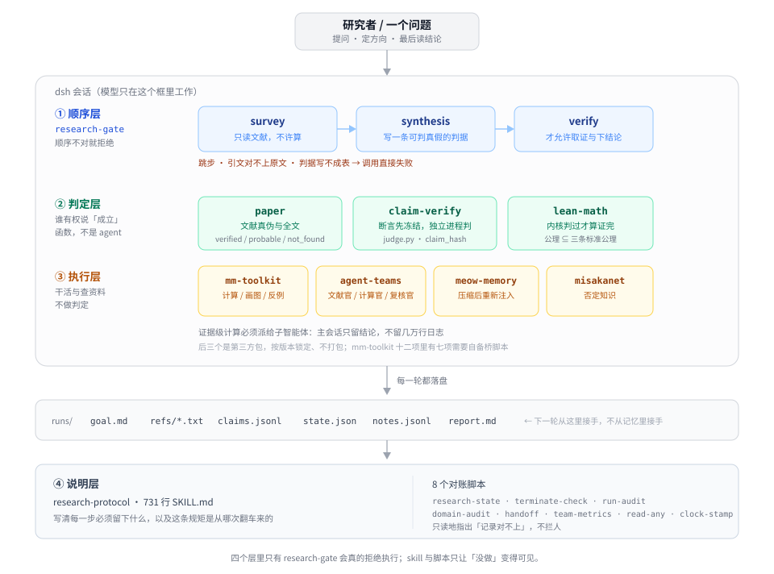

# dsh-math-flow

**一套给数学研究用的 agent 工作流。它不给模型加能力，它限制模型做事的顺序：先读文献、再写判据、最后才允许开算。**

[English](README.md) · 运行在 DeepSeek Harness（`dsh`）上 · 判定依赖 Lean 4 + Mathlib

> 状态：Alpha，可安装、可跑通。只在 `dsh 0.1.5-rc.2` 上验证过，详见[第五章](#五现状与期望)。

**目录**：[一、困境](#一现有-agent-的困境以-dsh-为例) · [二、框架](#二我们搭的框架) · [三、插件与-skill](#三插件与-skill) · [四、安装](#四安装) · [五、现状与期望](#五现状与期望)

---

## 一、现有 agent 的困境（以 dsh 为例）

下面八条不是推测。它们是同一类任务（读一个数学问题、查前人做到哪、试着算或证）在 dsh 上跑长会话之后记下来的，时间跨度几个月，每一条都能指到具体某一轮。

| # | 困境 | 在 dsh 上的具体表现 | 后果 |
|---|---|---|---|
| 1 | **顺序会塌** | 给一个开放问题，它读 0 篇文献、调 0 次论文工具，花 5 分钟设计数值搜索，准备跑到 10⁵ | 无界问题上小范围搜索的信息量接近零；真正有用的信息在「为什么这里应该没有解」里 |
| 2 | **定义会漂** | 一个符号第 5 轮定义，第 40 轮开始走样，第 60 轮在证关于另一个对象的命题 | 长推导中途失效，而且不报错 |
| 3 | **自己判自己** | 提出断言的人，顺手宣布它成立 | 「验证通过」可能和要证的命题无关 |
| 4 | **只有真假两值** | 判定接口没有「无结论」，于是「没找到反例」被写成「成立」 | 报告系统性虚高 |
| 5 | **压缩即失忆** | 上下文压缩后，摘要里的错误前提被当成事实继续用；同一会话里既做实验又下结论 | 错误被固化成结论，复审者继承同一套前提 |
| 6 | **工具越多越乱** | 同一个 agent 既能查文献又能算，它会在两者之间摇摆，且总是摆向能立刻出数字的那边 | 加插件不解决问题，反而加剧问题 |
| 7 | **装了不等于生效** | 版本漂移导致插件静默降级或不挂载；两个记忆插件抢同一个注入位，得到的是一段话写两遍 | 排查成本高，表现仍是「没报错」 |
| 8 | **没有度量** | 改完之后只能说「这次感觉好一点」 | 无法判断哪条改动有用，也无法砍掉没用的东西 |

三条最典型的，值得单独说：

**跳过文献。** 那次的问题是「单位正方形内是否存在到四个顶点距离都为有理数的点」。模型没有读任何文献，直接开始设计搜索算法，目标是跑到 `c ≤ 10^5`。这个规模的搜索既证明不了存在，也证明不了不存在，但它看上去像在推进工作。

**自证。** 一次审计里出现了 `theorem trivial_thing : 1 = 1`，而 `assertion` 字段写着一条完全无关的定理。判定结果：P，零公理，所有检查通过。检查器没有说谎，它只是被喂了一个不相干的东西。

**装了但没生效。** 插件目录里有十几个包，profile 里实际挂载的少一个，而 `dsh` 不报错。后来才定下规矩：校验必须读 `dsh --dump-config`，核对每个插件的**实际组件 id**，不能按包名猜。

这八条有一个共同点：**都不报错**。模型不会说「我忘了定义」，它会接着往下算，输出格式完全正确。所以靠提示词、靠换更强的模型都压不住——这也是这个仓库存在的理由：把约束从「应该」挪到工具层，变成「不能」。

## 二、我们搭的框架

整个设计只有一句话：**能机械判定的做成函数，顺序做进门禁，剩下的写成文档并允许对账。**

框架分四层。图里是同一样东西，文字是补充。

<p align="center"></p>

| 层 | 管什么 | 由谁实现 | 违反时会发生什么 |
|---|---|---|---|
| ① 顺序层 | 现在处于哪一步、这一步允许做什么 | `research-gate` | 工具调用直接返回失败，并说明缺什么 |
| ② 判定层 | 谁有权说「成立」 | `lean-math` / `claim-verify` / `paper` | 判不了就返回错误或「无结论」，不给假通过 |
| ③ 执行层 | 查资料、算、画图、组队 | `mm-toolkit` + 三个第三方包 | 缺依赖时明确报缺哪个，不假装成功 |
| ④ 说明层 | 每一步必须留下什么 | `research-protocol` skill + 8 个对账脚本 | 不拦人，只把「没做」变得可见 |

### ① 顺序层：research-gate

一个状态机，把研究分成三段，只允许向前：

```
survey ──→ synthesis ────→ verify
只读文献     写一条判据       才允许取证
```

它拦的是四件事：

- **跳步。** 没走完 survey 就想开算，`research_stage(advance)` 直接失败。
- **引文造假。** survey 要求至少两条原文引文，来自不同文献文件。判定方式是在文件里做子串匹配——改写、拼接、翻译都不算。
- **判据不成形。** synthesis 必须产出一条能读成 `judge + predicate + value` 的判据，外加「什么结果会推翻它」。散文不算。
- **批量计算留在主会话。** 证据级与探索级计算必须派给子智能体，主会话只留结论，不留下几万行中间日志。

计算按规模分三级，不按学科分：`scratch`（单次求值，任何阶段都放行，但输出要标 `[scratch]`）、`evidence`（有循环、有上界、有枚举语义）、`explore`（上界 ≥10⁵、蒙特卡洛、参数扫描）。另有一条频次规则：同一个问题里草稿级算满 8 次，后续调用自动升格为证据级——「分一百次小算」不能绕过门禁。

v0.4 起按角色做工具硬隔离：文献官拿不到 `viz_python`，计算官拿不到 `paper_*`，复核官专门找反例。工具在子会话的 schema 里根本不存在，所以无从违背。

这里有一条血泪规则：**宁可放宽，不可卡死**。某些 profile 里既没有 `subagent` 也没有 shell，强制委派会让流程永远走不动。门禁会先探测当前会话有没有可用委派工具；没有就放行，但计入 `directRuns` 并在状态里显示「降级直跑 N」。降级是可见的、可统计的，不是悄悄失效。

### ② 判定层：谁也不许自己发证书

- **`lean-math`** 把 Lean 内核接进来。`lean_verify_proof` 是最终裁判；`lean_axioms` 检查每条声明依赖哪些公理，`uses_sorry: true` 表示证明其实没做完。判 `proven` 的条件写死在代码里：公理集合必须是 `{propext, Classical.choice, Quot.sound}` 的子集，且 `autoImplicit` 关闭。
- **`claim-verify`** 解决的是「产出数据的人和下判决的人是同一个人」。它把两者拆成两个进程：脚本只负责打印数据（每行一个 JSON），`judge.py` 只按事先声明的 `expect` 下判决。判决之后，断言原文按 hash 冻结；事后改一个字，`claim_audit` 会把它报成一条独立事件，而不是默默接受。
- **`paper`** 管「文献是不是真的存在、能不能拿到全文」。引用核验只有三档：`verified`（标题相似度 ≥ 0.9，无年份/作者冲突）、`probable`（0.75–0.9，需人工核对）、`not_found`（< 0.75，视为未验证，不许写进正文）。盗版镜像在 `checkPolicy()` 里被拒绝，这条写在代码里，不是写在文档里。

### ③ 执行层：干活的地方，不做判定

`mm-toolkit` 负责计算与画图，三个第三方包分别提供记忆、团队、否定知识。它们都能失败，失败时说清楚缺什么；没有一个能签发结论。

### ④ 说明层：把「应该」写清楚，并允许对账

`skills/research-protocol/SKILL.md` 有 731 行，逐条说明每个阶段必须留下什么、为什么，以及这条规矩是从哪次翻车来的（约 30 条具名失败模式，带轮次）。配套 8 个脚本读运行目录，检查记录自洽不自洽。

这一层**不强制任何东西**。skill 不加载就等于不存在；脚本要你自己跑、自己看结果。真正会拦住你的是 `research-gate`。把两者混为一谈，是这类项目最常见的吹法。

### 一次任务实际怎么走

1. 把目标写成 `goal.md`：问题、成功判据、明显不做的事、为什么难。
2. **survey**：用 `paper_*` 检索、解析开放全文、核验引用；留下四个答案（谁做过、化成了什么、用了什么手段、卡在哪一步）和两条原文引文。
3. **synthesis**：写一条判据和它的推翻条件。写不成表就退回上一步。
4. **verify**：先写 `prediction` 与 `confidence`，再跑。证据级计算派给计算官；定理交给 `lean_verify_proof`；数值断言交给 `verify_claim`。
5. **写报告**：每条陈述标 `[文献已知]` / `[我算出的]` / `[scratch]` / `[推测]`，断言附 `claim_hash`。
6. **收工**：跑 `terminate-check` 与 `run-audit`，确认 `state.json` 和 `claims.jsonl` 对得上，再宣布结束。

## 三、插件与 skill

仓库里是 5 个插件包（36 个工具）、3 个 skill、8 个对账脚本。下面逐个说清楚它们做什么、拒绝什么。

### 3.1 `lean-math` — 内核判定（13 个工具）

把 Lean 4 证明助手接进 harness：开一个常驻语言服务器，imports 只加载一次，之后每一步只重新解析改动的部分。

| 工具 | 作用 |
|---|---|
| `lean_status` | 检查 elan / lean / lake / curl 是否可用 |
| `lean_open_file` / `lean_sessions` / `lean_close_session` | 开、列、关交互式证明会话 |
| `lean_get_goals` | 读当前目标与诊断（「眼睛」） |
| `lean_run_tactic` | 追加一步 tactic 并返回新状态（「手」） |
| `lean_update_source` | 在同一会话里换定理，复用已加载 imports（约 1 秒，而不是 40–60 秒） |
| `lean_undo` | 回退到任意检查点，干净地放弃一条思路 |
| `lean_verify_proof` | 用内核严格验证完整代码（最终裁判） |
| `lean_axioms` | 查每条声明的公理依赖，识别 `sorry` |
| `lean_deps` | 依赖图：传递闭包、所属模块、边 |
| `lean_query` | 会话内 `#check` / `#eval` / `#print` / `#reduce` |
| `lean_search_premise` | 在 Mathlib 里检索定理（leansearch / moogle / premise-search） |

**它拒绝什么**：编译不过、带 `sorry`、公理超出允许集合、`autoImplicit` 未关闭的证明，一律不算 `proven`。它不评价定理重不重要，只回答「内核认不认」。

### 3.2 `claim-verify` — 冻结断言（4 个工具）

| 工具 | 作用 |
|---|---|
| `verify_claim` | 跑脚本、读 JSON 行、按事先声明的 `expect` 判定，并冻结断言 hash |
| `claim_audit` | 检查一条判据是否在判决之后被改过 |
| `lean_audit` | 编译 Lean 文件并给出四种结局之一：`proven` / `computed` / `failed` / `blocked` |
| `research_note` | 往研究台账追加一条记录 |

**它拒绝什么**：判定结论不可翻译成 `judge + predicate + value` 的判据；扰动每个输入行都翻转不了结果的「真空通过」（`verdict: "vacuous"`）；声明与数据对不上的脚本。

### 3.3 `research-gate` — 顺序门禁（1 个工具）

只有一个对外的 `research_stage`，能力全在状态机里：阶段推进、票据（换问题必须重开一张票）、草稿额度、计算分级、委派检查、角色工具策略、以及拒绝时给出**当前会话里真实可见**的替代路径。

**它拒绝什么**：跳步、证据级计算留主会话、判据没写就派批量任务、换问题不换票、引文对不上原文。拒绝文案按实际可见工具渲染——早期版本会推荐没装的工具，这条是修出来的。

### 3.4 `paper` — 文献层（6 个工具）

| 工具 | 作用 |
|---|---|
| `paper_search` | 并行查 OpenAlex / Crossref / arXiv / zbMATH，按 DOI + 标题相似度去重 |
| `paper_resolve` | 给 DOI / arXiv 号 / 标题找合法开放全文（Unpaywall + OpenAlex + arXiv） |
| `paper_fetch` | 抓正文，三级降级 + 本地 PDF 解析，落盘并记台账 |
| `paper_verify` | 核验一条引用是否真实存在（标题相似度 + 年份/作者一致性） |
| `paper_ledger` | 看/记 `refs/ledger.jsonl`，跨会话知道上次从哪拿到的 |
| `paper_channels` | 通道自检：哪个源通、PDF 后端在不在 |

**它拒绝什么**：解析不到全文时不假装读到；引用不到 `verified` 或 `probable` 就标 `not_found`；盗版镜像直接拒绝。

### 3.5 `mm-toolkit` — 计算、画图、反例（12 个工具，可选档）

| 工具 | 作用 | 现状 |
|---|---|---|
| `viz_python` / `viz_matlab` / `viz_tex` | 跑 Python / MATLAB / TikZ，产物落盘 | 开箱，需对应工具链 |
| `viz_list` / `viz_doctor` | 列出产物 / 体检 | 开箱 |
| `viz_see` / `viz_gen` | 读图 / 生成位图 | 需自备桥脚本 |
| `browser` / `browser_read` / `browser_status` | 常驻 Chrome，跨调用保留状态 | 需自备 `browserd.py` |
| `cnki` | 知网研学检索 | 需自备账号与桥脚本 |
| `think` | 五角色多轮审辩 | 需自备登录态 |

十二项里五项开箱可用，七项要自备桥脚本，所以不放在默认路径上。缺依赖时返回 `ok: false` 并说明缺哪个文件，不会假装成功。

### 3.6 skills — 协议与操作手册（3 个，另 3 个随 Danus）

| skill | 是什么 | 行数 |
|---|---|---|
| `research-protocol` | 研究协议本体：三步顺序、每步的交付物、约 30 条具名失败模式 | 731 |
| `cordis-plugin-development` | 扩展这个宿主之前怎么查：要真实的 service / slot / schema，不要从名字猜 API | 420 |
| `editing-cordis-compositions` | composition 规则：插件行什么时候挂载、什么时候挂了但不贡献、patch 层能改哪里 | 165 |

另有一组只随 `--with-danus` 安装：`danus-main`（主智能体契约）、`danus-elaboration`
（五节综合模板 + consult）、`danus-initialize`（首次配置访谈）。它们属于 3.8 那套系统。

`research-protocol` 点名的 8 个脚本（3673 行，只依赖 Node 内置模块与彼此）：

| 脚本 | 作用 |
|---|---|
| `research-state.mjs` | 目标与状态对账、距离、surprise、给下一轮切片的 `--slice` |
| `terminate-check.mjs` | 这一轮能不能收工（交付、blocking 的 attempt、析取底线） |
| `run-audit.mjs` | 报告对台账：hash、等级提升、作废传播、回收 |
| `domain-audit.mjs` | 问出 `space` 问不出的「内层参数」问题 |
| `handoff.mjs` | 从 report + claims 生成下一轮的交接，不从记忆里生成 |
| `team-metrics.mjs` | 从会话日志算压缩次数、交接成本、判决覆盖率 |
| `read-any.mjs` | 读 `>` 重定向产生的 UTF-16LE 文件 |
| `clock-stamp.mjs` | 给出一个可引用的时间戳（模型自己算不准时间） |

分工是刻意的：

| | 是什么 | 能做什么 | 不能做什么 |
|---|---|---|---|
| skill | 一份 `SKILL.md` | 讲清该产出什么 | 不强制，不加载就等于不存在 |
| 脚本 | 只读运行目录 | 指出记录对不上 | 不拦人，要自己跑 |
| 插件 | 挂进宿主的组件 | 真的拒绝 | 只能判机械可判的部分 |

### 3.7 没有进仓库的部分

还有六个留在作者的单机上：`math-strategies`、`proof-harness`、`watchdog`、`wps-bridge`、`hotloader`、`ollama`。原因分三类：

- `watchdog`、`wps-bridge` 依赖特定的宿主构建或本机 WPS，搬出来也跑不起来；
- `hotloader`、`ollama` 是开发/本地工具，不属于研究流程；
- `math-strategies` 实测负收益：在作者的 220 次跑批记录里，15 次失败有 9 次是模型其实写对了、但在策略阶段被丢掉。`proof-harness` 与之同类。这两个不发布，是因为它们没通过自己的实验，不是因为没来得及。

清单和各自缺什么写在 [`packages/README.md`](packages/README.md)。

### 3.8 `danus` — 把另一套系统接进来（可选，`--with-danus`）

这一节和前七节不是一类东西：前面是**这套流水线自己的层**，这里是**通往另一个系统的桥**。
[Danus](https://github.com/frenzymath/Danus)（北大董彬组的证明搜索编排系统）已经有自己
的主循环：worker 并行证、无状态 verifier 是唯一权威、通过的事实进内容寻址的图。它的
集成文档里有一句关键的话——*"Danus does not register tools in a dsh web profile."*
它把 dsh 当 worker 的后端，从没把 dsh 当主智能体的宿主。这个包补的就是这一半。

| 层 | 做什么 | 实现 |
|---|---|---|
| A 网关 | 让 dsh 看得见 `gm_*` / `fact_*` | 自实现 MCP stdio 客户端，启动时读一次 `tools/list` |
| B 控制面 | 启停那窝 worker | `danus` CLI 的 7 个 verb + `danus_doctor` |
| C 契约 | 让模型知道怎么用 | 三个 skill：`danus-main` / `danus-elaboration` / `danus-initialize` |

**为什么 A 不是「在 patch 里多挂一行 mcp-client」**：Danus 的权限边界是「角色能看到
哪些工具」，`main` 根本没有 `fact_submit`。挂载交给宿主，插件就拿不到那份清单，也就
无法断言边界有没有被绕过。所以这里每次启动读一次 `tools/list`，原样注册——多一个不
注册，少一个不补。测试里那条「main 看不到 fact_submit」就是这条边界的哨兵。

**平台现实**：`danus.gateway` 只依赖 stdlib + `mcp`；`danus.orchestration.cli` 第一行是
`import fcntl`，那是 Unix 的文件锁。整个 Danus 对 POSIX 的依赖只有四处，所以插件带了
一个 `pycompat/` 目录，通过 `PYTHONPATH` 只对插件启动的子进程生效：

| 上游用法 | 在 Windows 上会怎样 | `pycompat` 怎么做 |
|---|---|---|
| `fcntl.flock` | `ModuleNotFoundError`，整个 CLI 起不来 | `msvcrt.locking` 锁同一字节 |
| `os.kill(pid, 0)` | **会 `TerminateProcess`，把正在检查的 worker 杀掉** | `OpenProcess` 只探活 |
| `os.getpgid` / `os.killpg` | 属性不存在，`stop --force` 崩 | `taskkill /T /F` 杀进程树 |
| `/proc/<pid>/stat` | 读不到 | 上游已有 `except OSError`，自动退化为「活着」 |

不改上游一行代码，也不往系统里装任何东西。实测（Windows 11 + 仓库自带的 venv）：
`list` / `new` / `assign` / `status` 全部原生跑通，`danus_doctor` 的 `cli` 一项是 ok。
`launch.mode` 仍然按目标分开，`{gateway: python, cli: wsl}` 在有 WSL 的机器上照旧可用。

还剩一个不是平台问题的问题：`danus_start` 拉起 worker 需要模型后端（`CODEX_BACKEND=api`
要 OpenAI key，`dsh` 后端要 bash 去执行 `bin/codex-dsh`）。这一项没有默认值，doctor 不会
替你猜。

实测：真实 Danus 上四个角色的工具面分别是 `main` 5、`worker` 5（含 `fact_submit`）、
`verifier` 1、角色拼错 → 1（fail-closed）；`gm_add` 真写进了图；在 dsh 里启动
装好的 profile，13 个工具（5 网关 + 8 控制面）注册成功。

它**不**带 Danus 本体、**不**跑 worker、**不**做 write-paper（那是另一个 MCP 服务）。
详见 [`packages/danus/README.md`](packages/danus/README.md)。

## 四、安装

### 4.1 前置

| 需要 | 怎么装 | 说明 |
|---|---|---|
| Node ≥ 22.5 | 任意方式 | 插件是 ESM，`engines` 已声明 |
| `dsh` | `npm i -g @deepseek-ai/dsh` | **验证于 0.1.5-rc.2。** npm 的 `latest` 是 0.2.2-rc.5，未测 |
| `pnpm` | `npm i -g pnpm` | `dsh plugin` 会转发给它 |
| Lean 4 + Lake | `elan default leanprover/lean4:stable` | 没有它，判定返回错误而不是假通过 |
| Mathlib | `git clone` 后 `lake exe cache get` | `import Mathlib` 需要，约 4 GB |
| Python 3（可选） | 系统安装 | `claim-verify` 的判官、`mm-toolkit` 的绘图要它 |

### 4.2 一条命令

安装器会新建一个独立 profile（默认 `math-flow`），不碰你正在用的那个；装完插件后再装 skill——`dsh plugin add` 装不了 skill，所以有第二步。

```bash
git clone https://github.com/laoda12345576/dsh-math-flow && cd dsh-math-flow
node scripts/install.mjs                 # core：4 个插件 + 3 个 skill
```

```bash
node scripts/install.mjs --with-viz       # + mm-toolkit（计算/画图）
node scripts/install.mjs --tier full      # + mm-toolkit 与三个第三方包（记忆/团队/否定知识）
node scripts/install.mjs --with-purge     # + dsh-purge（full 档的 patch 层依赖它）
node scripts/install.mjs --no-skills      # 只装插件
node scripts/install.mjs --skills-dir <目录>   # skill 装到别处
node scripts/install.mjs --dry-run        # 只打印计划
node scripts/install.mjs --verify-only    # 只校验已有安装
node scripts/install.mjs --help           # 其余参数
```

实测输出（core 档，非示意）：

```
  ok   lean-math  (dsh-plugin-lean-math)
  ok   claim-verify  (dsh-plugin-claim-verify)
  ok   research-gate  (dsh-plugin-research-gate)
  ok   paper  (dsh-plugin-paper)
  profile math-flow: 156 components, 0 of 4 expected plugins missing

  ok   skill research-protocol
  ok   skill cordis-plugin-development
  ok   skill editing-cordis-compositions
  skills: 3 of 3 present in <DSH_HOME>/skills
```

三档实测：core = 156 个组件、4/4；`--with-viz` = 157、5/5；`--tier full` = 159、6/6。

校验读 `dsh --profile <名字> --dump-config`，核对每个插件的**实际组件 id**，不是包名——`misakanet@3.5.0` 挂载成 `misakanet-mcp`，按包名匹配会把健康的安装报成坏的。

### 4.3 装完之后

```bash
node scripts/doctor.mjs        # 缺哪个工具链，只读，不代装
dsh --profile math-flow        # 启动
```

`doctor` 刻意不替你装 Mathlib：那是 4 GB 的磁盘决定。Lean 和 Mathlib 缺失时，流水线仍然装得起来，只是每次判定返回错误——不会假通过。

## 五、现状与期望

### 5.1 现状

| 项 | 状态 |
|---|---|
| 代码 | 5 个插件包、3 个 skill、8 个对账脚本、2 个安装脚本，全部 MIT |
| 安装 | 三档实测通过；匿名 `git clone` 后 `--dry-run` 验证过 |
| 测试 | `research-gate` 93 项确定性测试全过；各包有 `npm test` 入口 |
| 宿主 | 仅 `dsh 0.1.5-rc.2`；0.2.x 未测 |
| 平台 | 仅在 Windows 上实测；路径已脱敏，但 Linux/macOS 没跑过 |
| CI | 没有 |
| 测量 | `lab/` 有协议和表结构，**还没有填进第一份真实数据** |
| 第三方 | 三个包按版本声明，不 vendor；五个第三方 skill 只给链接 |

诚实说三句：

- 这不是一个「装完就能证定理」的东西。它是一套让 agent 别乱来的约束，难题仍然要靠人和模型。
- 版本漂移是头号故障源。换 `dsh` 版本之前先跑 `--verify-only`。
- 没有可宣传的跑分。`lab/` 里是可复现的测量协议，不是成绩单。

### 5.2 期望

1. **在 dsh 0.2.x 上重测**，给出一个明确的兼容性矩阵，而不是「应该能用」。
2. **跑完第一轮三臂实验**（基线 / +记忆 / 全流水线），把 `lab/metrics.csv` 从表结构变成数据。
3. **把 `watchdog`、`proof-harness` 里可脱敏的部分搬出来**；依赖宿主构建的留在 `patches/` 并标明目标版本。
4. **加 CI**：干净容器里跑 `install --dry-run` 与各包测试。
5. **给 `research-protocol` 一份英文版**；现在只有中文，因为它是从中文实验记录里长出来的。

**这个仓库更欢迎「一次测量」，而不是「一个插件」。** 加插件很容易，说清楚它到底有没有用很难——上面那六个没发布的包，就是这么被砍掉的。

### 5.3 它不做什么

- 不能让弱模型证出难题。内核是法官，不是生成器。
- 不能代替你读文献。`paper` 取回并核验，不替你理解；survey 要求原文子串，就是为了挡「我知道」冒充「我读到」。
- 不保证跨宿主版本可用。
- 不提供「一键出论文」。`wps-bridge` 那类输出层没有发布。

想快速判断这东西值不值得看，读两份文件就够了：[`skills/research-protocol/SKILL.md`](skills/research-protocol/SKILL.md)（协议本体）和 [`docs/03-failure-log.md`](docs/03-failure-log.md)（十条复盘，其中三条变成了上面的规则）。

## 许可

MIT，见 [`LICENSE`](LICENSE)。
